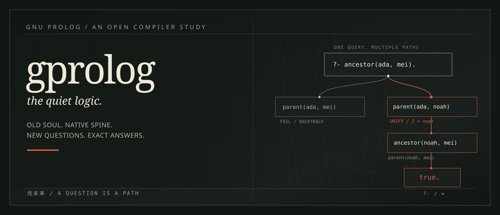
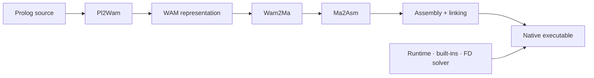
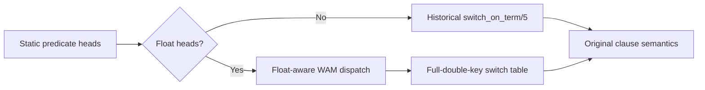

<div align="center">



<sub>侘未来 / WABI-FUTURISM · LOGIC / NATIVE CODE / CONSTRAINTS</sub>

# gprolog

### the quiet logic.

*A small query. A whole search space.*

**Old soul. Native spine. New questions. Exact answers.**

</div>

---

## 00 / Inheritance is part of the program

**GNU Prolog** is the native-code Prolog compiler and finite-domain constraint system developed by **Daniel Diaz**. Its compact compiled executables, ISO-oriented semantics, Warren Abstract Machine (WAM) pipeline and Prolog/C interface are the point of departure here—not legacy baggage to be discarded.

This repository is **a personal fork of GNU Prolog**, not a separate implementation or an official replacement for upstream. Its `master` branch retains the **GNU Prolog 1.6.0** base ([VERSION](VERSION), [NEWS](NEWS)) and now includes a narrowly scoped, experimental goal-expansion extension. Float first-argument indexing is being evaluated separately in [draft PR #2](https://github.com/jesusvilela/gprolog/pull/2), **not presented here as a shipped upstream feature**.

The original GNU Prolog [README](README) remains preserved, alongside a [verbatim archive](docs/UPSTREAM_README_1.6.0.txt). The upstream project's language, history, and licensing stay visible even as this fork's landing page evolves.

> **Change the compiler carefully. Keep the language recognizable.**

No invented benchmarks. No new semantics by renaming an old mechanism. No compatibility claim without executable evidence.

## 01 / One question, many paths

A small Prolog program is enough to remember what makes this language different:

```prolog
parent(ada, noah).
parent(noah, mei).

ancestor(X, Y) :- parent(X, Y).
ancestor(X, Y) :- parent(X, Z), ancestor(Z, Y).
```

Ask:

```prolog
?- ancestor(ada, mei).
```

The query can succeed through the recursive rule. The hero illustration is an **original, schematic proof-search tree**: a failed direct-parent attempt and a successful recursive path, not a captured debugger trace.

A Prolog query is not only a computation. It is a request to search the consequences of clauses, bindings and procedural control. That means optimizations must preserve more than an attractive final answer: **solution order, variable bindings, cut, exceptions and side effects** can all matter.

## 02 / The native spine

GNU Prolog is already a compiler. We are not proposing a JIT merely to make the project sound modern.



This is a **high-level orientation**, not a complete account of every supported input, intermediate representation or link-time step. The actual compiler components live in [`src/Pl2Wam/`](src/Pl2Wam/), [`src/Wam2Ma/`](src/Wam2Ma/) and [`src/Ma2Asm/`](src/Ma2Asm/).

The established GNU Prolog system includes native standalone compilation, an interactive top-level, debugging facilities, clause indexing, DCGs, a bidirectional C interface and an integrated finite-domain constraint solver. For complete scope and language semantics, consult the [upstream manual](doc/README).

## 03 / A guarded mutation

<sub>IN THIS FORK'S `master` · EXPERIMENTAL · NOT AN UPSTREAM GNU PROLOG FEATURE</sub>

**[Merged PR #1 — guarded goal expansion](https://github.com/jesusvilela/gprolog/pull/1)** introduces optional `goal_expansion/2` compilation hooks and the explicit `expand_goal/2` predicate. The intention is precise: specialize selected calls *before* WAM/native compilation without replacing GNU Prolog's compiler.

```prolog
goal_expansion(square(X, Y), Y is X * X).

area_of_square(Side, Area) :- square(Side, Area).
```

The implementation traverses documented control constructs rather than arbitrary data arguments, rejects hooks that bind or alias source-goal variables, and detects finite rewrite cycles. Hook definitions are protected from self-expansion; consulted code can inherit active hooks.

**Evidence:** 29/29 semantic checks in each of native and consulted execution, an expected rejection of unsafe rewrites, and native/emulated/interpreted bootstrap checks on the reviewed commit. These checks establish the tested subset; they are **not** full SWI-Prolog compatibility, a guarantee against infinite distinct rewrites, or a measured performance gain.

See [the exact scope and tests](docs/COMPILER_EVOLUTION.md). **Upstream GNU Prolog does not thereby acquire this feature.**

## 04 / The float-shaped question

<sub>DRAFT / UNDER REVIEW · [`feature/float-indexing`](https://github.com/jesusvilela/gprolog/tree/feature/float-indexing) · NOT YET ON `master`</sub>

**[PR #2 — static first-argument float indexing](https://github.com/jesusvilela/gprolog/pull/2)** extends, rather than replaces, GNU Prolog's WAM clause indexing. Where static float-headed clauses occur, the experimental branch emits `switch_on_term_flt/6` and `switch_on_float/1` backed by full `double` keys. Float-free groups retain the historical `switch_on_term/5` path.



The provisional implementation has passed 13 semantic checks per native/consulted path; targeted finite-float differential tests on Linux ELF64 and i686 ELF32; and deliberate near-full hash-collision tests (17 distinct keys sharing one starting bucket in an 18-slot table), including missing lookups and source-order duplicate answers. All results are **bounded to their fixtures**.

**Performance, carefully scoped:** three matched CI runs found approximately **6.01×–7.22×** native speedups for a synthetic 128-key float-heavy workload. Atom-only and variable-call controls were approximately unchanged. This is *not* a general GNU Prolog speedup, nor independent replication. NaN/infinity behavior, additional ABIs, and real-world workloads remain open.

Read the [benchmark protocol](https://github.com/jesusvilela/gprolog/blob/feature/float-indexing/docs/FLOAT_INDEX_BENCHMARK.md), [collision experiment](https://github.com/jesusvilela/gprolog/blob/feature/float-indexing/docs/FLOAT_INDEX_COLLISION_PROTOCOL.md), and [evidence ledger](https://github.com/jesusvilela/gprolog/blob/feature/float-indexing/docs/FLOAT_INDEX_AUDIT.json). **PR #2 remains draft and unmerged while those limits are evaluated.**

### Elsewhere in the search space

The following are research directions, not features of this fork's `master`:

| Direction | Reference ecosystems | Evidence needed before implementation |
| :-- | :-- | :-- |
| Wider and multi-argument indexing | SWI-Prolog, YAP | Source-order and backtracking preservation on representative applications |
| Assertions and modes | Ciao/CiaoPP | Explicit contracts and rejected unsafe assumptions |
| Incremental compilation | Modern iterative compiler workflows | Dependency correctness and compile-time measurements |
| Selective tabling | XSB | Precise recursion, negation, answer and memory semantics |
| Cleaner embedding | Trealla, Scryer, Clausal | Foreign resource ownership and backtracking-safe interfaces |

These projects inform design; they are **not an implied code source**. Any contribution must respect licensing, document a bounded contract, and bring reproducible evidence.

## 05 / Enter the machine

For an existing GNU Prolog installation with its executables on `PATH`:

```console
$ gprolog
| ?- write('hello from Prolog'), nl.
```

The standalone compiler is `gplc`. To compile an actual Prolog program stored in `hello.pl`:

```console
$ gplc hello.pl
```

To build from the source tree on a supported Unix-like environment:

```sh
cd src
./configure --with-install-dir=in-place
make
make install
make check
make check-e
make check-i
python3 ../tests/goal_expansion/run.py --bin-dir "$PWD/../bin"
```

Consult [INSTALL](INSTALL), [src/WINDOWS](src/WINDOWS), [PROBLEMS](PROBLEMS) and the [manual](doc/README) for the exact platform, toolchain, execution and troubleshooting requirements. The guarded goal-expansion tests now apply to this fork's `master`. The additional float-indexing checks live on [PR #2's branch](https://github.com/jesusvilela/gprolog/pull/2) until that change is separately accepted.

## 06 / An evidence ledger, not a leaderboard

Every compiler change should answer the same questions: *What is changed? What is preserved? Where can it fail? What evidence would make us withdraw the claim?*

- **Semantics before speed:** check substitutions, success/failure, answer order, cut, exceptions, side effects and dynamic predicates as applicable.
- **Native and interpreted paths:** compare the execution modes that the implementation actually touches.
- **Adversarial tests:** an invalid rewrite or a malformed goal must fail for the correct reason.
- **Reproducibility:** record toolchain, platform, exact commit and commands.
- **Attribution:** distinguish GNU Prolog's established features from this fork's additions and from other Prolog implementations' ideas.
- **Scientific humility:** a passing test suite validates its tested contract, not universal ISO conformance or a performance advantage.

The merged goal-expansion CI and the draft float-indexing CI are separately traceable from their linked PRs. The float measurements were produced by matched GitHub Actions runs with an independently authored *source-order model*, not an independent third-party laboratory. **A green CI suite is a tested scope, not a proof of universal semantics.**

## 07 / Provenance never gets optimized away

**GNU Prolog was developed by Daniel Diaz.** Its upstream development and bug tracker are at [didoudiaz/gprolog](https://github.com/didoudiaz/gprolog). The project site is [gprolog.org](https://www.gprolog.org/).

Since version 1.4.0, the GNU Prolog distribution has been available under a dual-license choice: **LGPL version 3 or later**, or **GPL version 2 or later**, or both in parallel, subject to the applicable notices and conditions. See [COPYING](COPYING) for the actual terms. This fork does not claim a new license over upstream code.

Please report whether a defect reproduces in upstream GNU Prolog or only in a proposed fork-specific feature. That single distinction preserves a surprising amount of engineering truth.

---

<div align="center">

### 間 — ma

*Between a goal and its proof, leave room for another path.*

**Keep the native spine. Let the logic breathe.**

<sub>gprolog · an evolutionary compiler study · no unearned claims</sub>

</div>
