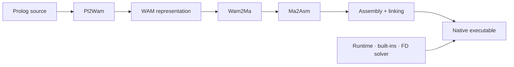

<div align="center">


<sub>侘未来 / WABI-FUTURISM · LOGIC / NATIVE CODE / CONSTRAINTS</sub>

# gprolog

### the quiet logic.

*A small query. A whole search space.*

**Old soul. Native spine. New questions. Exact answers.**

</div>

---

## 00 / Inheritance is part of the program

**GNU Prolog** is the native-code Prolog compiler and finite-domain constraint system developed by **Daniel Diaz**. Its compact compiled executables, ISO-oriented semantics, Warren Abstract Machine (WAM) pipeline and Prolog/C interface are the point of departure here—not legacy baggage to be discarded.

This repository is **a personal fork of GNU Prolog**, not a separate implementation or an official replacement for upstream. The `master` branch currently carries **GNU Prolog 1.6.0** (see [VERSION](VERSION) and [NEWS](NEWS)); the new compiler experiments belong to an **unmerged draft branch**.

The original GNU Prolog [README](README) is retained unchanged on `master`, with an additional [verbatim archive](docs/UPSTREAM_README_1.6.0.txt) so the original project voice is not lost when the compiler-evolution branch eventually replaces the landing page.

> **Change the compiler carefully. Keep the language recognizable.**

No invented benchmarks. No new semantics by renaming an old mechanism. No compatibility claim without executable evidence.

## 01 / One question, many paths

A small Prolog program is enough to remember what makes this language different:

```prolog
parent(ada, noah).
parent(noah, mei).

ancestor(X, Y) :- parent(X, Y).
ancestor(X, Y) :- parent(X, Z), ancestor(Z, Y).
```

Ask:

```prolog
?- ancestor(ada, mei).
```

The query can succeed through the recursive rule. The hero illustration is an **original, schematic proof-search tree**: a failed direct-parent attempt and a successful recursive path, not a captured debugger trace.

A Prolog query is not only a computation. It is a request to search the consequences of clauses, bindings and procedural control. That means optimizations must preserve more than an attractive final answer: **solution order, variable bindings, cut, exceptions and side effects** can all matter.

## 02 / The native spine

GNU Prolog is already a compiler. We are not proposing a JIT merely to make the project sound modern.



This is a **high-level orientation**, not a complete account of every supported input, intermediate representation or link-time step. The actual compiler components live in [`src/Pl2Wam/`](src/Pl2Wam/), [`src/Wam2Ma/`](src/Wam2Ma/) and [`src/Ma2Asm/`](src/Ma2Asm/).

The established GNU Prolog system includes native standalone compilation, an interactive top-level, debugging facilities, clause indexing, DCGs, a bidirectional C interface and an integrated finite-domain constraint solver. For complete scope and language semantics, consult the [upstream manual](doc/README).

## 03 / The first controlled mutation

<sub>EXPERIMENTAL / DRAFT — NOT PRESENT ON `master`</sub>

[**Draft PR #1 — guarded goal expansion**](https://github.com/jesusvilela/gprolog/pull/1) adds an optional compile-time specialization seam inspired by—but not copied from—SWI-Prolog's `goal_expansion/2` pattern.

```prolog
goal_expansion(square(X, Y), Y is X * X).

area_of_square(Side, Area) :-
    square(Side, Area).
```

In the **draft branch**, the compiler can rewrite the call before WAM/native compilation. The proposed implementation has a deliberately bounded contract: it traverses specified control constructs, leaves ordinary data arguments alone, rejects hooks that bind or alias the source goal, and detects finite rewrite cycles. That is **not** a claim of complete SWI-Prolog compatibility, semantic preservation for every user-authored hook, or measured speedup.

The precise semantics, exclusions, negative controls and local test claims are in the [compiler-evolution specification on the feature branch](https://github.com/jesusvilela/gprolog/blob/feature/goal-expansion/docs/COMPILER_EVOLUTION.md).

**The distinction matters:** a well-defined experiment deserves to be judged as an experiment. The `master` version does not yet expose this feature.

## 04 / The next branches of the search

The research directions below are **proposals**, not advertised shipping capabilities.

| Direction | Informed by | What must be established first |
| :-- | :-- | :-- |
| **Better indexing** | SWI-Prolog, YAP | Same observable answers, order and cut/side-effect behavior before performance claims |
| **Assertions and modes** | Ciao/CiaoPP | Explicit contracts and diagnostics before trusting optimization assumptions |
| **Incremental compilation** | Modern iterative compiler workflows | Correct dependency invalidation, with compile time measured independently |
| **Selective tabling** | XSB | Well-defined recursion, negation, answer and memory semantics |
| **Cleaner embedding** | Trealla, Scryer, Clausal | Resource ownership and backtracking-safe foreign interfaces |

Those systems are **sources of ideas, not undisclosed sources of copied code**. Any adoption needs compatible licensing, a bounded design, a regression oracle and evidence that the native compiler remains useful.

## 05 / Enter the machine

For an existing GNU Prolog installation with its executables on `PATH`:

```console
$ gprolog
| ?- write('hello from Prolog'), nl.
```

The standalone compiler is `gplc`. To compile an actual Prolog program stored in `hello.pl`:

```console
$ gplc hello.pl
```

To build from the source tree on a supported Unix-like environment:

```sh
cd src
./configure --with-install-dir=in-place
make
make install
make check
```

Consult [INSTALL](INSTALL), [src/WINDOWS](src/WINDOWS), [PROBLEMS](PROBLEMS) and the [manual](doc/README) for the exact platform, toolchain, execution and troubleshooting requirements. The goal-expansion tests in [draft PR #1](https://github.com/jesusvilela/gprolog/pull/1) require that branch and its own documented build/test procedure; they are **not a master-branch installation check**.

## 06 / An evidence ledger, not a leaderboard

Every compiler change should answer the same questions: *What is changed? What is preserved? Where can it fail? What evidence would make us withdraw the claim?*

- **Semantics before speed:** check substitutions, success/failure, answer order, cut, exceptions, side effects and dynamic predicates as applicable.
- **Native and interpreted paths:** compare the execution modes that the implementation actually touches.
- **Adversarial tests:** an invalid rewrite or a malformed goal must fail for the correct reason.
- **Reproducibility:** record toolchain, platform, exact commit and commands.
- **Attribution:** distinguish GNU Prolog's established features from this fork's additions and from other Prolog implementations' ideas.
- **Scientific humility:** a passing test suite validates its tested contract, not universal ISO conformance or a performance advantage.

The first experimental slice reports specific local checks in its own PR and specification. **This README edit has not independently rerun the compiler or benchmarked it.**

## 07 / Provenance never gets optimized away

**GNU Prolog was developed by Daniel Diaz.** Its upstream development and bug tracker are at [didoudiaz/gprolog](https://github.com/didoudiaz/gprolog). The project site is [gprolog.org](https://www.gprolog.org/).

Since version 1.4.0, the GNU Prolog distribution has been available under a dual-license choice: **LGPL version 3 or later**, or **GPL version 2 or later**, or both in parallel, subject to the applicable notices and conditions. See [COPYING](COPYING) for the actual terms. This fork does not claim a new license over upstream code.

Please report whether a defect reproduces in upstream GNU Prolog or only in a proposed fork-specific feature. That single distinction preserves a surprising amount of engineering truth.

---

<div align="center">

### 間 — ma

*Between a goal and its proof, leave room for another path.*

**Keep the native spine. Let the logic breathe.**

<sub>gprolog · an evolutionary compiler study · no unearned claims</sub>

</div>
