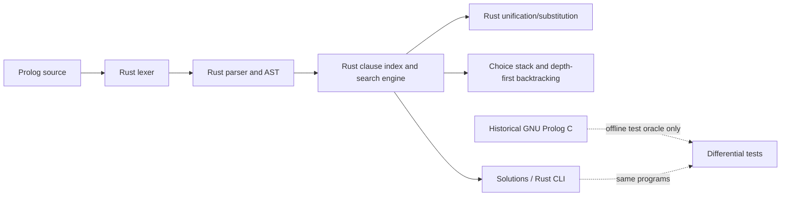

# 侘未来 / Direct Rust rewrite — architectural decision (17 November 2026)

## Decision

**Retire the staged C→Rust production-bridge strategy.** The previous
R0 decimal converter and R1 shadow-lexer experiments remain valuable,
reproducible research artifacts, but they are **not** the target
architecture. In particular, we will not ship a permanent dynamic
`dlopen` layer, dual parser feature flags, Rust/C fallbacks, or a
cross-language WAM runtime. A permanent compatibility bridge would
become a second product to maintain.

Start a **standalone, Rust-native Prolog system now**, keeping the C
GNU Prolog implementation only as an *offline differential oracle*.
Its code is not imported into the new runtime, and the native binary
does not load any C/Prolog bridge libraries.

The new entrypoint is `rust/gprolog-native`, initially a safe,
Rust-standard-library-only Horn-clause engine with its own lexer,
parser, unifier, search scheduler, CLI and tests. This is a direct
rewrite **of the architecture**, not a claim that all of GNU Prolog's
implemented functionality has already been reproduced.

## Single native architecture

All production runtime edges above are Rust-to-Rust. Rust R0/R1
compatibility reports are archived as evidence, not extended as
permanent modules of the new interpreter.

## First vertical slice — executable, deliberately bounded

- Facts, Horn rules, variable scopes, compound terms, integer and
  finite floating literals, lists, comments and quoted atoms.
- Standardization apart per clause invocation.
- Backtracking in textual clause order, recursive rules, unification
  on *finite* terms, explicit occurs-check as a temporary safety
  choice (this **differs** from GNU Prolog's rational-tree behavior).
- Core predicates `true/0`, `fail/0`, `=/2`, `\\=/2`.
- CLI loads a Prolog file and evaluates a query, printing solutions.
- Resource budgets to avoid silently unbounded search.
- No foreign interface, no GNU Prolog C linking, no WAM backend
  required to run this first executable.

## Explicitly not yet implemented

Full ISO Prolog operator precedence, if-then, negation, DCGs, dynamic
predicates, attributed variables, constraint domains, arithmetic,
exception handling, streams, cyclic/rational trees, the WAM bytecode,
GNU Prolog native code generation, foreign predicates, garbage
collection and full bootstrap. These are first-class **Rust
implementation obligations**, not covert calls to the C version.

The first runtime chooses a **safety-oriented occurs-check** and
bounded search instead of silently emulating GNU Prolog's cyclic
term and nontermination semantics. Such differences must be made
visible to tests and users. Do not claim ISO parity before these
semantics are settled.

## Rewriting the rest

A single Rust-native core gradually acquires modules for operator
parsing, goal control, arithmetic, term/heap representation, trail
and choice-point model, WAM instruction execution, the compiler,
finite-domain constraints and native code generation. There is
no separate 'portability base' bridging C subsystems: when a Rust
module replaces functionality, it owns it end-to-end.

The old C root remains frozen in this fork for provenance and
**offline comparative testing only**; no C file is migrated in
place until the new Rust executable supports the intended behavior.
Deprecating the historical C distribution is a separate release
decision, not implied by this work.

## License and evidence boundary

Historical GNU Prolog material retains its original authorship
and `COPYING` dual-license terms (LGPL v3+ OR GPL v2+). The new
Rust-native code uses the same dual licensing choice without
asserting wholesale relicensing of inherited material.

**P/A/M/H/S/R:** R0/R1 decimal compatibility remains M for its
bounded corpus; the present full native rewrite is H until its
binary actually builds and runs. 'Full GNU Prolog rewrite complete'
is H, not M. C parity can supply a reference, but not a proof of
all semantics or an independent third-party verification.

## Preregistered acceptance and stop rule

First vertical slice must build as a **Rust-only binary**, run
multiple solution examples (ancestor, member, append), preserve
variable freshness and clause order, reject cyclic terms safely,
respect search budgets, reject bad input without panic, and pass
CI tests across Linux ELF64 and i686 ELF32 when toolchains permit.

Kill the first-slice 'working engine' claim on a wrong answer,
cross-clause variable capture, failed unification rollback, syntax
acceptance outside the declared subset, a resource-budget bypass
or a crash. No production migration or rewrite completion claim
is authorized from a green smoke test. Once the first executable
is tested, promote only the implemented subset from H to M.

## First native execution (17 November 2026)

The standalone Rust CLI now exists at `rust/gprolog-native`, with a **root Cargo workspace** defaulting to it. No GNU Prolog C engine or C/Rust bridge is loaded. [Native CI #44052988720](https://github.com/jesusvilela/gprolog/actions/runs/44052988720) passed on Linux ELF64 and genuine i686 ELF32: **11 parser/unifier/engine tests, five CLI integration tests and four deterministic metamorphic tests per ABI**, zero failures. The malformed-input metamorphic test additionally exercised 512 seeded ASCII cases without a parser panic. The tests confirmed recursive ancestry, member and append lists, variable scoping, source-order backtracking, failure/unknown-predicate distinctions and explicit search-budget errors.

This promotes **only the documented finite Horn-clause subset to M (measured)**. The complete GNU Prolog rewrite remains H (unimplemented). The existing C source is retained solely as an offline oracle, while the old R0/R1 bridge strategy is explicitly superseded. See [RUST_NATIVE_AUDIT.json](RUST_NATIVE_AUDIT.json) for the typed claim and tests ledger.

## Control-flow extension: cut and disjunction (17 November 2026)

The first Rust-native control extension parses semicolon disjunction
with lower precedence than comma conjunction, parenthesized goal groups,
and the cut atom. The engine now carries a predicate-invocation
choice-stack barrier with each pending goal. A cut prunes alternatives
created inside its current invocation without erasing the caller's
earlier alternatives or later choices.

GitHub Actions 44073608503 passed **32 Rust tests per ABI** on Linux
ELF64 and i686 ELF32 (11 library, seven CLI, ten control-scope,
four metamorphic tests). Tests directly challenge cut-before/later
disjunction, cut followed by failure, nested caller scoping, and
answer order. The original C runtime is not linked by the executable.

This measured result is a bounded control-semantics extension, NOT
a WAM term heap, an efficient trail, complete ISO Prolog, or a
full GNU Prolog rewrite. The current stack still copies substitution
snapshots. See RUST_NATIVE_CONTROL.md for the frozen tests and
claim-specific evidence; no independent third-party replication.
